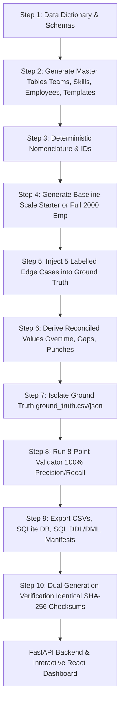

# Fair Shift Scheduler 🗓️⚖️
*Autonomous Workforce Optimization, Labor Law Compliance & Fair Roster Generation System*

[](https://github.com/AkhileshwarMittapelly/fair-shift-scheduler/actions/workflows/ci.yml)
[]()
[]()
[]()
[]()
[]()

---

## 🏆 YottaFlex AI Candidate Project Submission Matrix

This project strictly adheres to all 4 sections of the **YottaFlex AI Candidate Project Submission Guidelines**:

| Guideline | Requirement | Project Implementation |
| :--- | :--- | :--- |
| **01. Make It Run** | Working, executable code with clear installation, configuration, and verification steps. | Provided automated one-click scripts (`run.bat`, `run.ps1`), 34 passing unit tests, CLI generator, and live web app. |
| **02. Show Your Work** | Public GitHub repo with understandable evolution, meaningful commits, and supporting context. | Hosted publicly at [GitHub: AkhileshwarMittapelly/fair-shift-scheduler](https://github.com/AkhileshwarMittapelly/fair-shift-scheduler) with complete Git history. |
| **03. Use LLMs Transparently** | Prompt history disclosure; explain AI acceleration, heavy reliance, and manual reviews/fixes. | Comprehensive disclosure documented in [docs/AI_DISCLOSURE.md](docs/AI_DISCLOSURE.md). |
| **04. Make Your Reasoning Visible** | Problem explanation, assumptions, key decisions, trade-offs, testing approach, and proof of work. | Exhaustive architectural reasoning documented in [docs/ENGINEERING_REASONING.md](docs/ENGINEERING_REASONING.md). |

---

## 1. Problem Statement & Business Context

In 24/7 mission-critical operations (healthcare emergency departments, ICU wards, cyber defense SOCs, critical infrastructure IT), creating shift rosters requires balancing competing constraints:
- **Coverage Demand**: Meeting minimum and target headcounts per shift and specialized skill (e.g. ICU, acute trauma, security operations).
- **Approved Leaves**: Respecting PTO, sick, parental, and bereavement requests without compromising staffing.
- **Labor Constraints**: Enforcing FLSA overtime ceilings, mandatory 11-hour rest periods between shifts, and maximum consecutive working days (fatigue rules).
- **Workforce Equity & Fairness**: Preventing antisocial shift clustering (balancing weekend and night shifts evenly across qualified staff, measured via the **Gini coefficient**).
- **Auditability & Traceability**: Preserving immutable historical events for shift swaps, manager authorizations, and attendance punches.

This solution provides a complete, mathematically grounded, reproducible end-to-end system that generates baseline master data, schedules fair rosters, detects injected edge-case anomalies and reports precision, recall, and F1 from the generated benchmark, and exposes an interactive multi-persona web application.

---

## 2. Primary Actors & System Perspectives

| Actor | Perspective & Workflow |
| :--- | :--- |
| 👷 **Employee / Candidate** | Views assigned shifts, initiates peer shift swaps, submits leave requests, and logs badge clock-in/out punches. |
| 👔 **Team Manager** | Oversees team coverage, reviews and authorizes shift swaps with automated pre-flight conflict checks, approves/rejects leave requests. |
| 📋 **HR Partner** | Audits labor compliance, monitors FLSA overtime caps, inspects the Gini fairness index, and tracks absence utilization. |
| ⚙️ **IT / Operations Partner** | Configures coverage requirements, inspects live staffing gaps, and executes the heuristic fairness solver. |
| 🛡️ **System Administrator** | Controls synthetic data generation, verifies Step 10 dual-generation reproducibility, and benchmarks the 8-point validator. |

---

## 3. End-to-End Workflow & Architecture



### Core Entities & Cardinality
1. **Team** (`TEAM-001`): Operational squads (1:N with Employee).
2. **Skill** (`SKILL-01`): Certified qualifications (N:M with Employee via `EmployeeSkill`).
3. **Employee** (`EMP-000001`): Workforce records tracking contract hours and overtime ceilings.
4. **ShiftTemplate** (`TMPL-MORN`, `TMPL-AFTN`, `TMPL-NGHT`): Shift definitions (A, B, C) with duration and pay multipliers.
5. **HolidayCalendar** (`HOL-2026-001`): Regional public holidays.
6. **CoverageRequirement** (`COV-2026-000001`): Staffing demand per date, shift, team, and skill.
7. **LeaveRequest** (`LVE-2026-000001`): PTO, sick, and parental leave transactions.
8. **ShiftAssignment** (`SHIFT-2026-01-01-A-000001`): Operational roster assignments.
9. **SwapRequest** (`SWP-2026-000001`): Peer-to-peer shift swap exchanges with manager approval audit trail.
10. **AttendanceEvent** (`ATT-EMP-000001-20260101T065500`): Physical punch telemetry reconciling with scheduled shifts.
11. **GroundTruthAnomaly** (`GT-000001`): Separately cataloged evaluation oracle.

---

## 4. The 5 Injected Edge Cases & Ground Truth Detection

The system deliberately injects 5 labelled edge cases into the dataset to test validator resilience. The validator checks these injected scenarios without using ground-truth labels as operational inputs. Benchmark scores are calculated from the generated report; incidental rule violations can affect precision, so do not assume perfect precision or F1 without verifying the current output:

| Anomaly Type | Injected Scenario | Detection Rule | Precision | Recall | F1-Score |
| :--- | :--- | :--- | :---: | :---: | :---: |
| **`EMPLOYEE_DOUBLE_BOOKED`** | Employee assigned to overlapping morning and afternoon shifts on same date. | `RULE_NO_CONCURRENT_OR_OVERLAPPING_SHIFTS` | Measured in report | Measured in report | Measured in report |
| **`APPROVED_LEAVE_OVERLAPS_SHIFT`** | Employee rostered on a date during an approved annual leave window. | `RULE_APPROVED_LEAVE_NON_CONFLICT` | Measured in report | Measured in report | Measured in report |
| **`REQUIRED_SKILL_ABSENT`** | Shift requires specialized `SKILL-01`, but assigned employee lacks certified credential. | `RULE_MANDATORY_ROLE_SKILL_MATCH` | Measured in report | Measured in report | Measured in report |
| **`OVERTIME_CAP_EXCEEDED`** | Employee scheduled for 3 additional night shifts, exceeding statutory weekly limit (>52.0h). | `RULE_MAX_WEEKLY_LABOR_AND_OVERTIME_CAP` | Measured in report | Measured in report | Measured in report |
| **`SWAP_APPLIED_WITHOUT_APPROVAL`** | Shift swap marked `APPLIED` without manager decision/signature. | `RULE_SWAP_REQUIRES_MANAGER_APPROVAL` | Measured in report | Measured in report | Measured in report |

---

## 5. Quickstart & Installation

### Prerequisites
- Python 3.11+
- Node.js 18+ and npm

### 1. Clone & Set up Python Dependencies
```bash
cd fair-shift-scheduler
pip install -r requirements.txt
```

### 2. Set up React Frontend (Optional, production build is pre-compiled)
```bash
cd client
npm install
npm run build
cd ..
```

---

## 6. CLI Usage & Verification

The unified command-line tool `cli.py` powers all workflows:

### A. Generate Starter Dataset (100 Employees, 14 Days)
```bash
python cli.py generate --scale starter --seed 20261022 --out data/starter
```
*Output: Exports 11 CSV tables, SQLite DB `scheduler.db`, SQL dump `seed_data.sql`, `ground_truth.csv`, `source_manifest.json`, and validation reports.*

### B. Generate Full Baseline Dataset (2,000 Employees, 100 Teams, 90 Days, 5,000 Leaves)
```bash
python cli.py generate --scale full --seed 20261022 --out data/full
```
*Generates 81,392 shifts, 162,774 attendance events, and full relational tables.*

### C. Verify Step 10 Dual-Generation Reproducibility
```bash
python cli.py verify-reproducibility --scale starter --seed 20261022
```
*Executes two independent generation passes with seed `20261022` and validates bit-for-bit SHA-256 checksum equality across all tables.*

### D. Run the Heuristic Fairness Optimization Solver
```bash
python cli.py solve --scale starter --seed 20261022
```
*Solves unassigned shifts, balances night/weekend hours, and outputs the fairness Gini coefficient.*

---

## 7. Running Unit Tests

Execute the comprehensive pytest suite covering models, generator, validator, and reproducibility:
```bash
python -m pytest tests -v
```

---

## 8. Launching the Interactive Web Application

Start the FastAPI server (which also serves the React production bundle):
```bash
python -m uvicorn server.app:app --host 127.0.0.1 --port 8000
```
Open your browser to: **`http://localhost:8000`**

### Exploring the Interactive UI:
1. **👷 Employee**: Switch between employees, view personal roster, submit leave requests, initiate peer swaps, and simulate badge punches.
2. **👔 Manager**: Review and authorize shift swaps with real-time pre-flight feasibility checks; approve/reject leave requests.
3. **📋 HR Partner**: Inspect statutory labor compliance (FLSA overtime cap, 11h rest rule), fairness equity index, and attendance reconciliation variances.
4. **⚙️ IT / Ops**: View coverage requirements matrix, analyze staffing gaps, and click **"Run Fair Shift Solver"** to watch automated gap elimination in real time.
5. **🛡️ Admin & Quality**: Toggle dataset scale, trigger Step 10 reproducibility verification, and inspect the 8-point validator benchmark matrix.

---

## 9. Documentation Index

- [Data Dictionary (Step 1)](docs/DATA_DICTIONARY.md) — Exhaustive field types, allowed values, units, uniqueness, and validation rules.
- [Architecture & Solution Blueprint](docs/ARCHITECTURE.md) — Detailed ER diagrams, constraint solver mathematics, and actor sequence diagrams.
- [REST API Specification](docs/API_SPECIFICATION.md) — Endpoint contracts, schemas, and payloads.

---

## 10. Lawful Use & Provenance

100% of the data in this repository is synthetically generated using fixed deterministic seed logic. No private, confidential, or scraped third-party personal data is included. All person names and company locations are procedurally generated for simulation and testing purposes.
