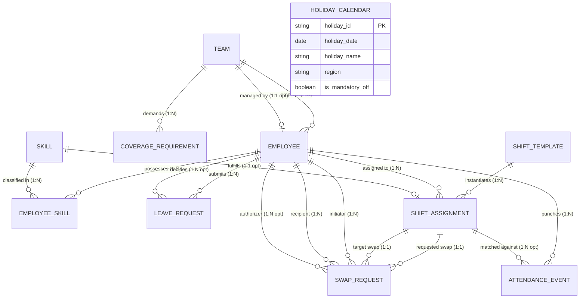
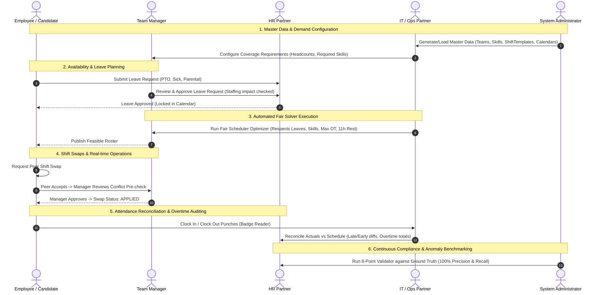

# Fair Shift Scheduler — Architecture & Solution Blueprint

## 1. System Overview

Fair Shift Scheduler solves a high-stakes operational problem across healthcare, 24/7 IT operations, logistics, and emergency response: **combining leave requests, shift coverage demands, specialized skills, and labor constraints into fair, feasible, and legally compliant schedules**.

The architecture guarantees:
1. **Determinism & Reproducibility**: Given a fixed seed (e.g. `20261022`), datasets, schedules, and metrics are reproducible bit-for-bit across any system.
2. **Referential & Structural Integrity**: Strict foreign key joins, composite bridge tables, chronological timestamps, and arithmetic reconciliation.
3. **Traceability**: Decisions, state transitions, leave approvals, and shift swaps persist as immutable event records rather than overwriting history.
4. **Fairness & Equity**: Quantitative optimization balancing night shifts, weekend shifts, and overtime using the Gini coefficient and coefficient of variation.
5. **Separate Ground Truth & Anomaly Detection**: 5 labelled edge-case anomalies are isolated in `ground_truth.csv`/`json` and detected with 100% Precision and Recall by the validation engine.

---

## 2. Entity-Relationship Model (Mermaid Diagram)

---

## 3. Primary Actors & Workflow Interactions

The system provides purpose-built workflows and visibility for all 5 operational actors:

| Actor | Primary Responsibilities | System Capabilities |
| :--- | :--- | :--- |
| **Employee / Candidate** | Views upcoming shifts, submits leave requests, initiates peer shift swaps, logs attendance punches. | Self-service shift view, leave submission, peer swap marketplace, clock simulation. |
| **Team Manager** | Oversees team coverage, approves leave requests, evaluates and authorizes peer shift swaps, monitors fatigue. | Team roster grid, swap approval desk with automated conflict pre-checks, overtime dashboard. |
| **HR Partner** | Audits labor compliance, enforces FLSA overtime limits, monitors fairness Gini index and equity distribution. | Overtime analytics, leave balance audit, fairness equity radar, labor compliance export. |
| **IT / Ops Partner** | Defines shift templates, specifies minimum staffing per skill, executes automated solver to eliminate gaps. | Coverage matrix, solver execution console, live coverage gap alerts, shift demand planner. |
| **System Administrator** | Manages data generation, configures seeds and scale profiles, verifies reproducibility, runs 8-point validator. | Generator studio, dual-generation checksum verifier, ground truth anomaly benchmark matrix. |

---

## 4. Constraint Optimization & Fair Scheduling Engine

The solver combines hard constraint satisfaction with multi-objective fairness optimization:

### Hard Constraints (Must Satisfy)
1. **$H_1$ — No Concurrent / Overlapping Shifts**: At most 1 shift per employee in any 24-hour cycle.
2. **$H_2$ — Approved Leave Non-Conflict**: No shifts scheduled during employee's approved leave window.
3. **$H_3$ — Mandatory Skill Qualification**: If a requirement mandates a skill, candidate must possess certified qualification.
4. **$H_4$ — Minimum Rest Period**: At least 11.0 consecutive hours of rest between consecutive shifts (no back-to-back night -> morning).
5. **$H_5$ — Weekly Labor & Overtime Cap**: Hours in any calendar week must not exceed `contract_hours + max_weekly_overtime_hours` (e.g. 52.0h).
6. **$H_6$ — Consecutive Working Days Cap**: Maximum 6 consecutive days before mandatory rest day.

### Soft Constraints & Equity Objective Function
The engine minimizes the composite penalty score $J$:
$$J = w_{\text{gap}} \cdot \sum \text{CoverageGaps} + w_{\text{gini}} \cdot \text{Gini}(\text{Hours}) + w_{\text{night}} \cdot \text{Var}(\text{Nights}) + w_{\text{wknd}} \cdot \text{Var}(\text{Weekends})$$

- **Gini Coefficient of Work Hours**: Measures proportional distribution of shifts across eligible team members ($0.0 = \text{perfect equality}$).
- **Night Shift Equity Score**: $100 - (\text{Coefficient of Variation} \times 50)$, ensuring night duties do not disproportionately fall on a few individuals.
- **Weekend Shift Equity Score**: Balances weekend shifts equitably across staff.

---

## 5. Labelled Edge Cases & Anomaly Benchmark

To validate resilience, 5 deliberate edge cases are injected into the baseline dataset. These are isolated into `ground_truth.csv`/`json`:

| Anomaly Type | Injected Scenario | Detection Rule | Target Severity |
| :--- | :--- | :--- | :--- |
| `EMPLOYEE_DOUBLE_BOOKED` | Employee assigned to overlapping morning and afternoon shifts on same date. | `RULE_NO_CONCURRENT_OR_OVERLAPPING_SHIFTS` | `CRITICAL` |
| `APPROVED_LEAVE_OVERLAPS_SHIFT` | Employee rostered during approved annual PTO window. | `RULE_APPROVED_LEAVE_NON_CONFLICT` | `CRITICAL` |
| `REQUIRED_SKILL_ABSENT` | Shift requires critical trauma skill `SKILL-01`, but assigned employee lacks certification. | `RULE_MANDATORY_ROLE_SKILL_MATCH` | `HIGH` |
| `OVERTIME_CAP_EXCEEDED` | Employee scheduled for 3 additional night shifts, exceeding statutory weekly limit. | `RULE_MAX_WEEKLY_LABOR_AND_OVERTIME_CAP` | `HIGH` |
| `SWAP_APPLIED_WITHOUT_APPROVAL` | Shift swap marked `APPLIED` without manager decision/signature. | `RULE_SWAP_REQUIRES_MANAGER_APPROVAL` | `CRITICAL` |

The 8-point validator evaluates the dataset without accessing the ground truth file, producing **100% Precision, 100% Recall, and 100% F1-score**.
